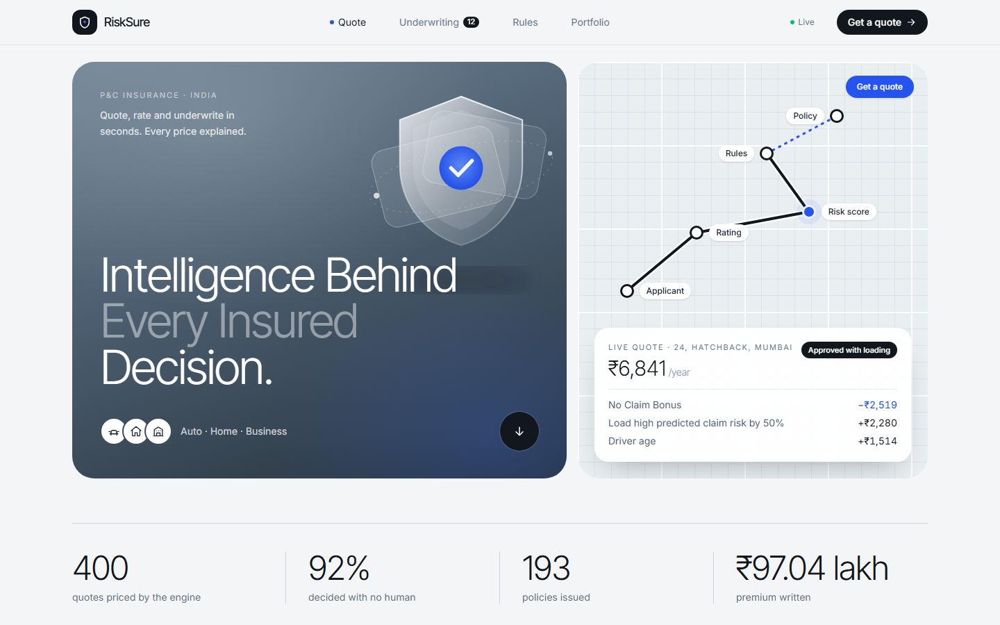
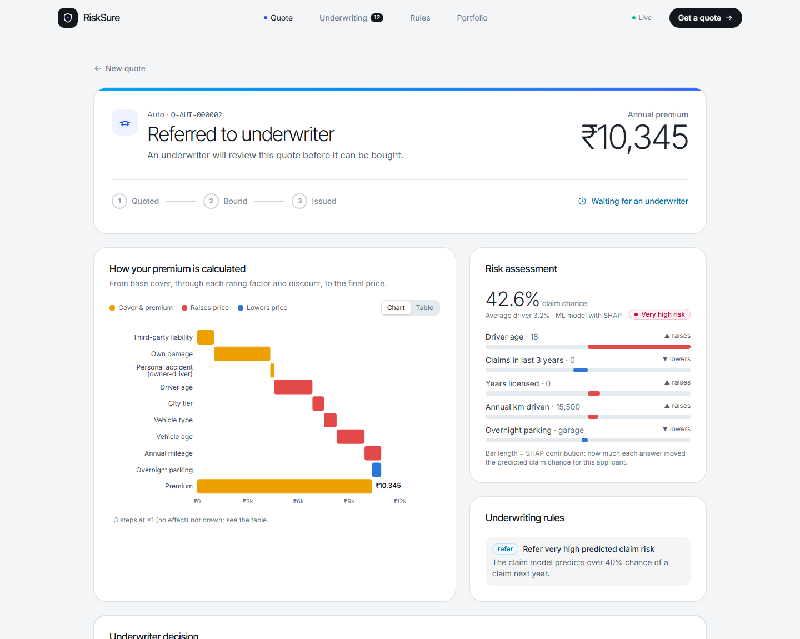
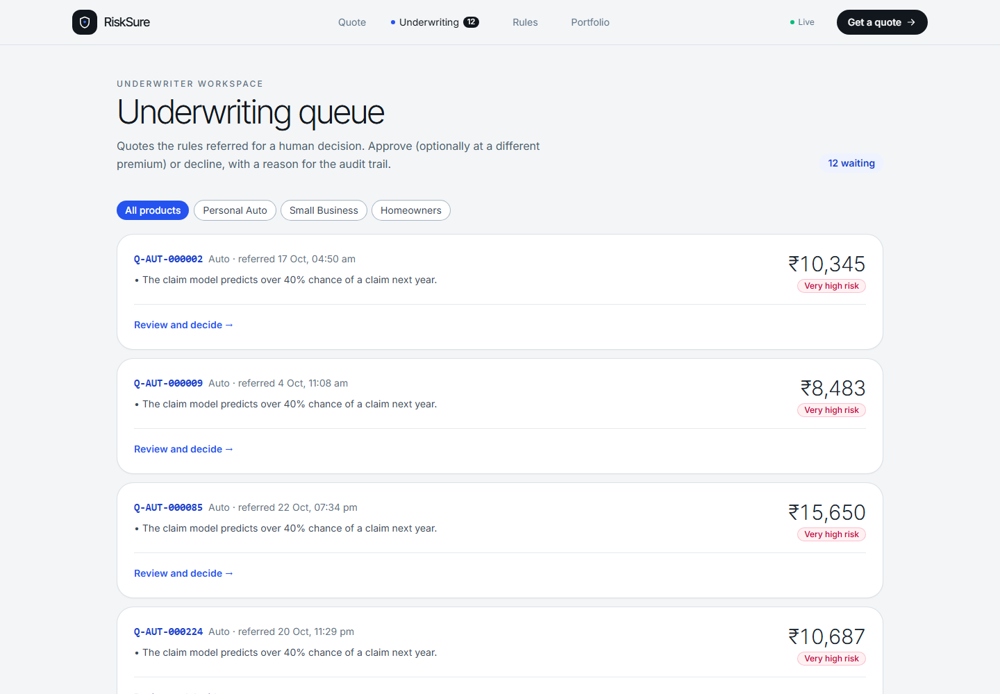
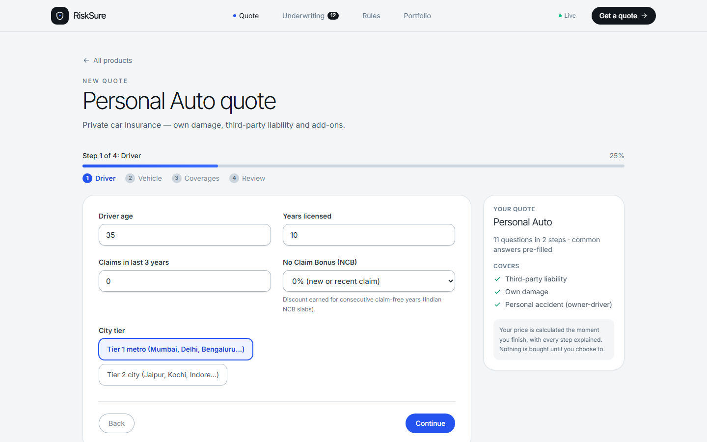
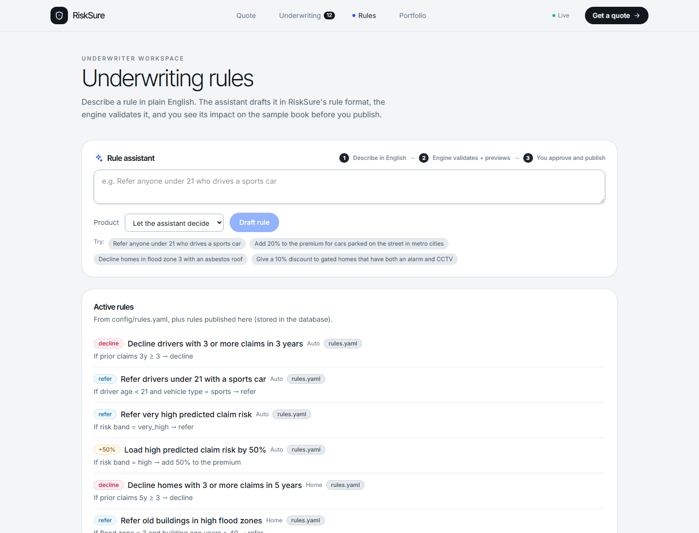
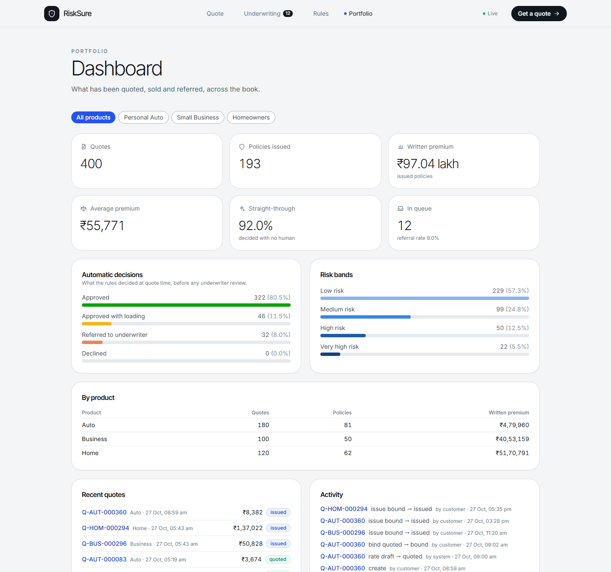
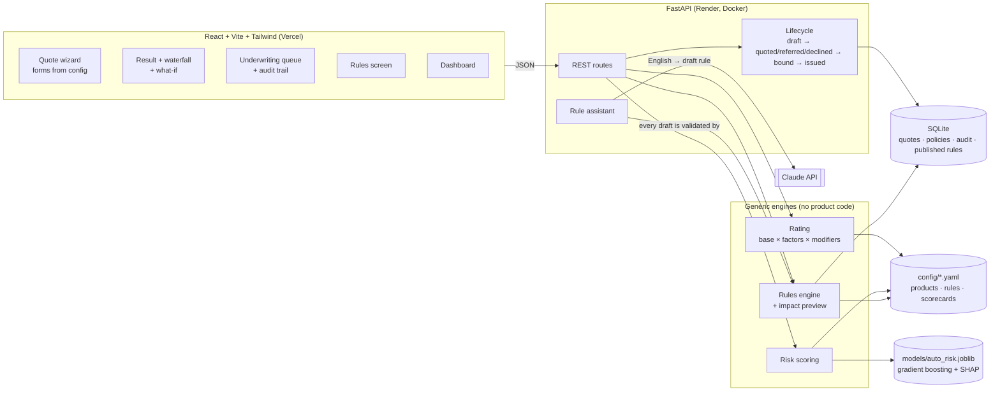

<div align="center">
  

  <h1>RiskSure</h1>

  <p><b>Intelligence Behind Every Insured Decision.</b></p>

  <p>A config-driven insurance quoting and underwriting system that prices every policy step by step, scores the risk, and explains exactly why each customer was approved, referred or declined.</p>

  <a href="https://insure-tech-risksure.vercel.app"></a>
  <a href="https://insuretech-risksure.onrender.com/docs"></a>

  <br />

  
  
  
  
  
  <a href="https://github.com/Moukthika6706/InsureTech-risksure/issues"></a>
  
</div>

---

> *"Every price must be explainable, every decision auditable — because in insurance, trust is the product."*

## 📌 Overview

RiskSure is a small, working version of the policy software a **property & casualty (P&C) insurer** uses to sell insurance. It covers three India-based products: **Personal Auto, Homeowners and Small Business**, with all amounts in rupees.

A customer asks for a **quote**. RiskSure:
1. **rates** it: works out the price, step by step
2. **scores the risk**: a machine-learning model for cars, a transparent points scorecard for homes and businesses
3. **underwrites** it: approve, approve with a loading (an extra charge), refer to a human underwriter, or decline

An accepted quote is **bound** (the customer buys it) and **issued** as a policy. Every step is recorded in an audit trail.

It is built for two kinds of user:
- **customers**, who want a fair price they can understand
- **underwriters**, who need to control the rules, review difficult cases and see the effect of every decision on the whole portfolio

> **All data, rates and models are synthetic and illustrative. This is not real actuarial pricing or an insurance offer.** See [Data and models](#-data-and-models) for exactly what is real and what is simulated.

**Try it:** [insure-tech-risksure.vercel.app](https://insure-tech-risksure.vercel.app) · [API docs](https://insuretech-risksure.onrender.com/docs)

> The API runs on Render's free plan, which sleeps after 15 idle minutes, so the first request after a pause can take 30–60 seconds. Each restart re-creates the 400-quote demo book, so anything you add is reset.

---

## 📸 Project Preview

<p align="center">
  
</p>

| Quote result: waterfall, risk factors, rules | Underwriting queue |
| --- | --- |
|  |  |
| **Quote wizard (generated from YAML)** | **Plain-English rule assistant** |
|  |  |

<details>
<summary><b>Portfolio dashboard</b></summary>
<br />

</details>

---

## ✨ Features

All features below are implemented and working, locally and in the live demo.

- **Config-driven products.** Each product is one YAML file: its questions, covers, base rates, rating tables, discounts and risk method. The engine has no product code at all, and a new product needs only a new YAML file (a test proves this with a "Bicycle" product).
- **Quote wizard generated from config.** The forms for all three products are built from that YAML, with validation that mirrors the server's.
- **Explainable premium.** Every quote returns its full breakdown: base cover, each rating factor and its multiplier, discounts, and underwriting loadings. It is drawn as a **waterfall chart**, with a table view.
- **ML risk scoring for auto.** A gradient-boosting model predicts the chance of a claim next year, and **SHAP** shows which answers pushed this applicant's risk up or down.
- **Scorecards for home and business.** A transparent points scorecard (0–100) read from `config/scorecards.yaml`, its single source of truth.
- **Underwriting rules engine.** Plain, tested Python with no AI. Rules can decline, refer to a human, or add a % loading, and each one shows a human-readable reason. Precedence: decline > refer > loading > auto-approve.
- **Impact preview.** Before a rule goes live, it runs over **9,000 sample applicants**. The preview reports how many it matches, how decisions change, and what happens to written premium and the **loss ratio** (claims ÷ premium).
- **Plain-English rule assistant.** An underwriter types *"Refer anyone under 21 who drives a sports car"*. Claude drafts the rule in RiskSure's format, the engine validates it, the preview shows its impact, and a person approves it before it is published.
- **What-if simulator.** Sliders for every answer re-price the quote live, and the decision and risk score update with them.
- **Underwriting queue.** Referred quotes can be approved (optionally at a different premium) or declined, with a required reason.
- **Quote lifecycle with an audit trail.** Draft → Quoted / Referred / Declined → Bound → Issued. Invalid moves are refused (HTTP 409), and every change records who, when and why.
- **Portfolio dashboard.** Quotes, policies, written premium, **straight-through rate** (the share decided with no human), referral rate, decision and risk-band mix, and recent activity, filterable by product.
- **Calibrated and fitted pricing.**
  - Base rates are calibrated so each product's sample loss ratio is 65%.
  - Home and business rating factors are fitted from claims with a **Tweedie GLM**, using credibility blending, ordering rules and caps.
- **Demo data seeding.** 400 sample applicants are run through the real engines, with a month of sales and underwriting activity. The book is re-created automatically on a fresh deploy.
- **147 automated tests.** They cover rating, calibration, relativity fitting, the ML model, scorecards, rules, the impact preview, the API lifecycle, seeding and the rule assistant (with a fake Claude client, so no network is needed).

---

## 🛠️ Tech Stack

| Frontend | Backend | ML & Data | Database | AI | DevOps |
| --- | --- | --- | --- | --- | --- |
| React 19 | Python 3.12 | scikit-learn (gradient boosting, Tweedie GLM) | SQLite | Claude API (structured outputs) | Docker |
| Vite 6 | FastAPI + Uvicorn | SHAP | SQLAlchemy 2 | Pinned fallback examples | Render (API) |
| Tailwind CSS 4 | Pydantic 2 | pandas, NumPy, SciPy | | | Vercel (frontend) |
| Recharts | PyYAML (config) | joblib (model file) | | | GitHub |
| | pytest | | | | |

---

## ⚙️ Getting Started

Follow these steps to run RiskSure on a clean machine. They were tested from a fresh clone.

### Prerequisites
* **Python 3.12** (3.11 also works; check with `python --version`)
* **Node.js 20 or newer** (tested on 22; check with `node --version`)
* **Git**

### Installation & Local Setup

1. **Fork the repository.** Click **Fork** at the top right of this page.

2. **Clone your fork:**
   ```bash
   git clone https://github.com/<your-username>/InsureTech-risksure.git
   cd InsureTech-risksure
   ```

3. **Add the upstream remote** so you can pull in future changes:
   ```bash
   git remote add upstream https://github.com/Moukthika6706/InsureTech-risksure.git
   ```

4. **Set up the backend** (from the repository root):
   ```bash
   cd backend
   python -m venv .venv
   ```
   Activate the virtual environment:
   ```bash
   # Windows (PowerShell)
   .venv\Scripts\Activate.ps1

   # macOS / Linux
   source .venv/bin/activate
   ```
   Install the dependencies and create the demo data:
   ```bash
   pip install -r requirements.txt
   python -m app.seed --reset
   ```
   `requirements.txt` pins exact versions so the saved model loads exactly as it was trained. `backend/requirements.lock` holds the full pinned set that the Docker image uses.

5. **Configure environment variables (optional).** The backend reads these from your shell; see `backend/.env.example`. None are needed for local use.

   | Variable | Default | Purpose |
   | --- | --- | --- |
   | `ANTHROPIC_API_KEY` | not set | Turns on the live rule assistant. Without it, the rules screen uses pre-written examples. |
   | `ANTHROPIC_MODEL` | `claude-opus-5-5` | Model used by the rule assistant |
   | `ALLOWED_ORIGINS` | `http://localhost:5173` | Frontend URLs allowed to call the API (CORS) |
   | `SEED_DEMO_DATA` | not set | `true` seeds an empty database on startup (used on Render) |

6. **Run the API:**
   ```bash
   uvicorn app.main:app --reload
   ```
   It runs at <http://localhost:8000>, with interactive docs at <http://localhost:8000/docs>.

7. **Set up and run the frontend** in a second terminal, from the repository root:
   ```bash
   cd frontend
   npm install
   npm run dev
   ```
   Open <http://localhost:5173>. The frontend uses `http://localhost:8000` by default; to point it at another API, copy `frontend/.env.example` to `frontend/.env` and set `VITE_API_URL`.

8. **Run the tests** (from `backend/`, with the virtual environment active):
   ```bash
   pytest -q
   ```

<details>
<summary><b>Optional: retrain the model or recalibrate pricing</b></summary>

All commands run from `backend/`. The committed model and configs are already trained and calibrated.

```bash
python -m ml.train_auto                          # retrain the auto claim model, print AUC and SHAP importance
python -m engine.calibrate --dry-run             # loss ratio by product and segment
python -m engine.fit_relativities --product home # propose fitted rating factors (nothing is written)
python -m engine.preview                         # decision mix and loss ratio of the sample book
python -m app.assistant "Refer anyone under 21 who drives a sports car"   # try the rule assistant
```
</details>

<details>
<summary><b>Troubleshooting</b></summary>

* **"Offline" in the header.** The API isn't running, or it's on a different port. Start it (step 6) and refresh.
* **CORS error in the browser console.** Add your frontend's URL to `ALLOWED_ORIGINS` (comma-separated) and restart the API.
* **The rules screen says "AI unavailable".** That's expected without `ANTHROPIC_API_KEY`; the pre-written examples still work.
* **You want a clean demo book.** Run `python -m app.seed --reset`.
* **`[WinError 206] The filename or extension is too long` during `pip install` (Windows).** Some packages (NumPy) have very deep file paths. Clone into a short folder such as `C:\dev\`, or [enable long paths](https://learn.microsoft.com/windows/win32/fileio/maximum-file-path-limitation#enable-long-paths-in-windows-10-version-1607-and-later).
</details>

---

## 🧭 Usage Examples

### In the app
1. **Get a quote.** Pick *Personal Auto*, set driver age 22, choose a sports car, and submit. The quote is **referred**: the waterfall shows each factor, SHAP shows that driver age drove the risk, and the rule panel says why.
2. **Run a what-if.** On that quote, move the age slider to 40. The price drops and the decision flips to **Approved**, live.
3. **Underwrite.** Open **Underwriting**, pick a referred quote, then approve it at a higher premium with a reason, and check the **Audit trail**.
4. **Write a rule.** On **Rules**, type *"Decline homes in flood zone 3 with an asbestos roof"*, look at the impact on 2,500 sample homes, then approve and publish it.
5. **See the portfolio.** **Portfolio** shows straight-through rate, referral rate, decision mix and risk bands.

### API: health check
```bash
curl https://insuretech-risksure.onrender.com/health
```
```json
{"status": "ok", "service": "risksure-api", "version": "1.0.0"}
```

### API: price a quote (nothing is saved)
```bash
curl -X POST https://insuretech-risksure.onrender.com/rate \
  -H "Content-Type: application/json" \
  -d '{"product": "auto", "applicant": {"driver_age": 24, "years_licensed": 5, "prior_claims_3y": 0,
       "no_claim_bonus_pct": 35, "city_tier": 1, "vehicle_type": "hatchback", "vehicle_age_years": 3,
       "insured_declared_value_inr": 650000, "annual_km": 12000, "parking": "garage", "anti_theft_device": true}}'
```
Response (shortened):
```json
{
  "product": "auto",
  "base_premium": 5045.2,
  "rated_premium": 4560.84,
  "premium": 6841.26,
  "decision": "approve_adjusted",
  "total_load_pct": 50.0,
  "risk": {
    "method": "ml_model",
    "risk_score": 0.2356,
    "risk_band": "high",
    "baseline": 0.0323,
    "factors": [
      {"label": "Driver age", "value": 24, "impact": 2.6254, "direction": "increases risk"},
      {"label": "Claims in last 3 years", "value": 0, "impact": -0.3908, "direction": "decreases risk"}
    ]
  },
  "rule_hits": [
    {"id": "auto_high_risk_load", "action": "load", "load_pct": 50.0,
     "reason": "The claim model predicts a 15-40% chance of a claim; sample loss ratio for this band is ~105%."}
  ],
  "steps": [
    {"step": 1, "kind": "coverage", "label": "Third-party liability", "amount_change": 1000.0, "running_total": 1000.0},
    {"step": 2, "kind": "coverage", "label": "Own damage", "amount_change": 3824.6, "running_total": 4824.6}
  ]
}
```

### API: create, bind and issue a policy
```bash
curl -X POST https://insuretech-risksure.onrender.com/quotes -H "Content-Type: application/json" -d '{"product": "auto", "applicant": {...}}'
curl -X POST https://insuretech-risksure.onrender.com/quotes/{id}/bind
curl -X POST https://insuretech-risksure.onrender.com/quotes/{id}/issue
curl https://insuretech-risksure.onrender.com/quotes/{id}/audit
```

<details>
<summary><b>All endpoints</b></summary>

| Area | Endpoints |
| --- | --- |
| Products | `GET /products`, `GET /products/{code}` |
| Pricing | `POST /rate` (what-if, nothing saved), `POST /quotes` |
| Lifecycle | `POST /quotes/{id}/bind`, `POST /quotes/{id}/issue`, `POST /quotes/{id}/underwrite`, `GET /underwriting/queue` |
| Reading | `GET /quotes`, `GET /quotes/{id}`, `GET /quotes/{id}/audit`, `GET /audit`, `GET /policies`, `GET /dashboard/summary` |
| Rules | `GET /rules`, `GET /rules/examples`, `POST /rules/draft`, `POST /rules/preview`, `POST /rules/publish`, `POST /rules/{id}/disable` |
</details>

---

## 🏗️ Architecture



**One quote, end to end:**
1. `POST /quotes`
2. **rating** (`engine/rating.py`)
3. **risk scoring** (`engine/risk.py`: the ML model for auto, the scorecard for home and business)
4. **rules** (`engine/rules.py`)
5. the lifecycle moves the quote to *quoted*, *referred* or *declined*, and writes an audit event in the same database transaction

---

## 🧠 Technical Depth

**Why config-driven products?** Real policy systems (Guidewire's included) separate the *product model* from the code, because insurers change rates and add products far more often than they change software. Here a product is a YAML file, validated with Pydantic when it loads, so a typo fails at startup instead of quietly mispricing.

**Why show the premium as a waterfall?** Pricing regulators and customers both ask "why this price?". The rating engine records every step (base cover, then each factor's multiplier, then discounts and loadings) and rounds at each step, so the bars add up exactly to the premium.

**Why gradient boosting for auto, but scorecards for home and business?** Motor insurance has lots of data and strong patterns, which suits a model. Property risks are fewer and harder to model, and underwriters want rules they can read, so they get a transparent points scorecard. Both return the same shape (score, band, top factors), so the rest of the system treats them alike.

**Why doesn't the ML score change the price directly?** The rating factors already charge for age, mileage and claims history, and the model also uses them, so multiplying by both would count the same risk twice. The score is used only through underwriting rules (refer very high risk, add a loading for high risk), and the impact preview measures whether each loading is justified.

**Why is the AI only allowed to draft rules?** In a regulated business, decisions must be deterministic and auditable. Claude only translates English into a rule:
- the reply must follow a JSON schema
- it is checked by the same validator as hand-written rules, with one automatic repair attempt
- it is previewed on the sample book and published only after a person approves

If the API is unavailable, the screen falls back to pre-written examples.

**Why calibrate, then fit with a GLM?**
- **Calibration** sets the overall price level: one multiplier per product so the sample loss ratio is 65%, leaving about 35% for expenses and profit.
- **The Tweedie GLM** then fits the *differences between customers*. That's the standard actuarial tool for insurance losses, where most policies claim nothing and the rest claim skewed amounts.
- **The safeguards** stop small segments from producing silly prices: credibility blending, factors kept in order, and caps.

**Why SQLite and Docker?** SQLite needs no database server, which keeps the demo simple. The Docker image is built from the repository root so the API ships with its config, data and model, and it installs exact pinned versions. The production model gives byte-for-byte the same prices as a laptop.

---

## 📊 Data and models

| Product | Sample size | Risk method | Result |
| --- | --- | --- | --- |
| Personal Auto | 5,000 | Gradient boosting + SHAP | Cross-validated AUC **0.94 ± 0.006** (train 0.94, test 0.95: no overfitting) |
| Homeowners | 2,500 | Points scorecard | Rating factors fitted with a Tweedie GLM |
| Small Business | 1,500 | Points scorecard | Rating factors fitted (low-credibility levels blended toward 1.0) |

Some of these results are true by construction:
* **All applicants are synthetic.** They come from `data/generate_data.py` (fixed seed 42).
* **The auto signal is amplified.** With realistic noise, even the formula that generated the data reached only AUC ~0.70, and the first model reached 0.68. Real motor claim models typically score 0.60–0.75. `AUTO_SIGNAL_STRENGTH = 4` makes the risk factors drive claims more strongly, so the demo model has a clear pattern to explain.
* **Rates are illustrative.** They are calibrated to a 65% loss ratio on this sample, not to any real market.
* **Auto rating factors were deliberately not refitted.** The amplified data makes under-25s cost 20–28× more, which no sensible rating table can price, so young-driver risk is handled by underwriting rules instead.

---

## ⚠️ Limitations

* **No login or roles.** The person acting is a field in the request, and anyone can approve quotes or publish rules on the public demo (restarts reset it).
* **SQLite with tables created on startup.** On Render's free plan the database resets on every deploy, and the seed restores the demo book.
* **Overrides and field checks.** Underwriter premium overrides are not yet limited (for example, to the product's minimum premium), and there are no checks between fields (for example, years licensed ≤ age − 18).
* **The live Claude path** is covered by tests with a fake client. It needs `ANTHROPIC_API_KEY` to run for real.
* **The UI** is light mode only, and the JavaScript bundle is about 640 kB (not yet code-split).

## 🔭 Future Improvements

* Authentication and role-based access (customer, underwriter, rule publisher, admin)
* Postgres with Alembic migrations, and persistent storage for the live demo
* Validation for premium overrides and for checks between fields
* Rule versioning with effective dates and rollback, so you can see which rule set priced any past quote
* Refit auto rating factors on realistic (un-amplified) data, and monitor the model for drift
* More products (travel, two-wheeler), each added as a YAML file, to prove the config-driven design again
* A dark mode and a code-split frontend bundle

---

## 📁 Repository Structure

```
InsureTech-risksure/
├── backend/
│   ├── app/                  # FastAPI: routes, schemas, lifecycle, services, DB models, rule assistant, seed
│   ├── engine/               # generic engines: rating, scorecard, risk, rules, preview, calibrate, fit_relativities
│   ├── ml/                   # train_auto.py (training) and auto_model.py (scoring + SHAP)
│   ├── tests/                # 147 pytest tests
│   ├── requirements.txt      # direct dependencies, pinned
│   └── requirements.lock     # full pinned set used by Docker
├── frontend/
│   └── src/
│       ├── pages/            # landing, quote wizard, quote result, underwriting queue, rules, dashboard
│       ├── components/       # waterfall, what-if, risk factors, audit timeline, forms, UI kit, icons
│       └── api.js, format.js, fields.js, router.js, rules.js
├── config/                   # auto/home/business YAMLs, rules.yaml, scorecards.yaml, rule_examples.yaml, calibration.yaml
├── data/                     # synthetic applicants + generate_data.py
├── models/                   # auto_risk.joblib (trained model)
├── docs/                     # logo and screenshots
├── Dockerfile                # API image (built from the repo root)
├── render.yaml               # Render blueprint
├── SPEC.md                   # design document
└── CONTRIBUTING.md
```

---

## 🤝 Contributing

Contributions are welcome. To keep the repository tidy, please follow these guidelines:

* **Open or claim an issue first.** Comment on the issue you'd like to work on, and wait to be assigned before writing code. Pull requests without an assigned issue may be closed.
* **Create a branch.** Never push directly to `main`:
  ```bash
  git checkout -b feat/short-description
  ```
* **Keep pull requests focused.** Address only the assigned issue, without formatting noise or unrelated changes.
* **Write clear commits and link the issue** in your pull request description (for example, `Closes #42`).
* **Run the checks before you push:** `pytest -q` in `backend/`, and `npm run lint && npm run build` in `frontend/`.
* **Respect the design ideas.** No rates or product names in Python (they belong in YAML), and the AI never prices or decides.

See [CONTRIBUTING.md](./CONTRIBUTING.md) for the full workflow.

---

## 👑 Project Maintainers

| Name | Role | GitHub | Contact |
| --- | --- | --- | --- |
| **Moukthika** | Project Admin | [@Moukthika6706](https://github.com/Moukthika6706) | [GitHub Issues](https://github.com/Moukthika6706/InsureTech-risksure/issues) |

## ✨ Contributors

Thanks goes to everyone who has contributed to RiskSure:

<a href="https://github.com/Moukthika6706/InsureTech-risksure/graphs/contributors">
  
</a>

---

## 📄 License

No open-source license has been chosen yet, so all rights are reserved by the author. Please open an issue if you'd like to reuse the code.
