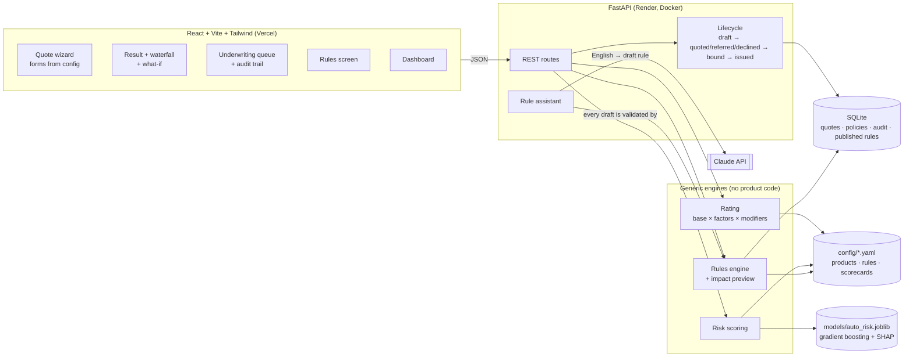

# RiskSure

A small, working version of the software a property & casualty (P&C) insurer uses to sell policies. It covers three India-based products: **Personal Auto, Homeowners and Small Business** (amounts in ₹).

A customer asks for a **quote**. RiskSure **rates** it (works out the price, step by step) and **scores the risk**. It then **underwrites** it: approve, approve with a loading, refer to a human underwriter, or decline. An accepted quote is **bound** (the customer buys it) and **issued** as a policy. Every change is recorded in an audit trail.

> **All data, rates and models are synthetic and illustrative. This is not real actuarial pricing.** The applicants come from `data/generate_data.py` (fixed seed). The auto data's risk signal was deliberately strengthened so the demo model has a clear pattern to learn; see [Data and models](#data-and-models).

**Live demo:** _frontend URL_ · **API docs:** _backend URL_/docs (added after deployment)

---

## What you can do in the app

| Screen | What it shows |
|---|---|
| **Quote wizard** | Pick a product; the form is generated from that product's YAML config (one page per field group, then coverages, then review). |
| **Quote result** | The decision, the premium as a **waterfall chart** (base cover → each rating factor → discounts → underwriting loading), the top risk factors (SHAP for auto, scorecard points for home and business), the rules that fired, and bind → issue. |
| **What-if simulator** | Sliders for every answer; each change re-prices live through `POST /rate` (nothing is saved). |
| **Underwriting queue** | Referred quotes, oldest first. Approve (optionally at a different premium) or decline, with a required reason. |
| **Audit trail** | Every status change on a quote: who, when, why. |
| **Rules** | Type a rule in plain English; Claude drafts it in RiskSure's rule format, the engine validates it, an impact preview runs it over 9,000 sample applicants, and the underwriter approves before it is published. |
| **Dashboard** | Quotes, policies, written premium, straight-through rate, referral rate, decision and risk-band mix, recent activity, filtered by product. |

## Architecture



One quote: `POST /quotes` → **rating** (`engine/rating.py`) → **risk** (`engine/risk.py`: the ML model for auto, the scorecard for home and business) → **rules** (`engine/rules.py`) → the lifecycle moves the quote to *quoted*, *referred* or *declined* and writes an audit event in the same database transaction.

## Design ideas

1. **Config-driven products.** Fields, coverages, rates, rating tables, modifiers, risk method and rules all live in `config/`. The engines contain no product names or rates. Any YAML with `kind: product` is a product: a test defines a new "Bicycle" product in YAML alone and prices it with no code change. Configs are validated with Pydantic on load (`engine/schema.py`), so a typo fails loudly instead of mispricing quietly.
2. **Explainable premium.** `rate()` returns every step: `{label, detail, multiplier, amount_change, running_total}`. Amounts are rounded at each step, so the waterfall adds up exactly to the premium.
3. **Two ways to score risk.**
   - **Auto** uses a gradient boosting model of next-year claim probability, with **SHAP** showing how much each answer moved this applicant's score.
   - **Home and business** use a transparent points **scorecard** read from `config/scorecards.yaml`, the single source of truth. The engine reproduces the generator's points for all 4,000 sample homes and businesses.
   - The score affects the decision and price **only through underwriting rules**, never as a hidden multiplier, so nothing is counted twice.
4. **Underwriting rules engine.** Plain, testable Python with no AI.
   - Rules are conditions (`all`/`any`, 8 operators, ordered risk bands) plus an action: decline, refer, or load the premium by a %. Precedence is decline > refer > loading > auto-approve.
   - `preview_rule` runs a proposed rule over the cached sample book and reports how many applicants match, how decisions change, and what happens to written premium and the loss ratio.
5. **Plain-English rule assistant** (`app/assistant.py`).
   - Claude translates text into a rule draft using **structured outputs**. The schema is generated from the product configs and kept flat, because structured outputs don't support recursion.
   - The underwriter's text is fenced as data.
   - The draft goes through the *same* validator as `rules.yaml`, with one automatic repair attempt. Then come the impact preview and explicit approval.
   - If the API is unavailable (no key, timeout, rate limit, refusal), the closest pre-written example is offered, so the screen still works.
   - The key comes from `ANTHROPIC_API_KEY` and the model from `ANTHROPIC_MODEL`; neither is in git.
6. **Quote lifecycle with an audit trail.** `app/lifecycle.py` is the only code that changes a status. Invalid moves return HTTP 409, and every change writes an `AuditEvent` in the same transaction. Rules published from the UI are stored in the database, not in YAML, because the host's disk is wiped on redeploy.

## Data and models

| Product | Rows | Risk method | Notes |
|---|---|---|---|
| Auto | 5,000 | Gradient boosting (scikit-learn) + SHAP | Cross-validated AUC **0.94 ± 0.006** (train 0.94, test 0.95: no overfitting). |
| Home | 2,500 | Points scorecard | Rating factors fitted from claims (see below). |
| Business | 1,500 | Points scorecard | Rating factors fitted from claims; most levels have few claims, so credibility blending matters. |

The data is synthetic, and some of the results are by construction. In particular:
- **The auto signal was amplified.** With realistic noise, even the formula that generated the data reached only AUC ~0.70, and the first model reached 0.68. Real motor claim models typically score 0.60–0.75. The generator's `AUTO_SIGNAL_STRENGTH = 4` makes the risk factors drive claims more strongly, so the demo model has a clear pattern to explain.
- **Rates were calibrated** (`engine/calibrate.py`) so each product's **loss ratio** (claims ÷ premium) on the sample is 65%. One multiplier is applied per product, and the rating factors are untouched.
- **Home and business rating factors were fitted** (`engine/fit_relativities.py`) with a **Tweedie GLM** (log link, power 1.5) of claims per rupee of base premium, using each YAML's own bands. Three safeguards apply: credibility blending under 30 claims, factors forced to stay in order, and caps of 0.5–5. Afterwards every risk band with 30 or more claims is within 20 points of target.
- **Auto was deliberately not refitted.** The amplified data makes under-25s cost 20–28× more, which no sensible rating table can price. Young-driver risk is handled by underwriting rules instead (very high predicted risk → refer, high → +50%).
- **Starter rules** (`config/rules.yaml`) are sized from the measured segment loss ratios. On the seeded demo book, **92% of quotes are decided with no human** (straight-through).

## Run it locally

**Backend** (Python 3.12; from `backend/`):

```bash
python -m venv .venv
.venv/Scripts/python -m pip install -r requirements.txt
.venv/Scripts/python -m app.seed --reset
.venv/Scripts/python -m uvicorn app.main:app --reload
```

On macOS/Linux, use `.venv/bin/python` instead of `.venv/Scripts/python`. The API runs at <http://localhost:8000>, with interactive docs at `/docs`. The seed command creates about 400 demo quotes (a month of quotes, sales and referral decisions) through the real engines.

**Frontend** (from `frontend/`):

```bash
npm install
npm run dev
```

It opens at <http://localhost:5173>. `VITE_API_URL` points it at the API (default `http://localhost:8000`).

**Rule assistant (optional):** set `ANTHROPIC_API_KEY` (and optionally `ANTHROPIC_MODEL`) in the shell before starting the API. Without a key, the rules screen uses the pre-written examples. You can try it from the terminal:

```bash
.venv/Scripts/python -m app.assistant "Refer anyone under 21 who drives a sports car"
```

**Retrain or recalibrate:** these are optional, because the committed model and configs are already calibrated.

```bash
.venv/Scripts/python -m ml.train_auto
.venv/Scripts/python -m engine.calibrate --dry-run
.venv/Scripts/python -m engine.fit_relativities --product home
.venv/Scripts/python -m engine.preview
```

## Tests

From `backend/`:

```bash
.venv/Scripts/python -m pytest -q
```

There are 147 tests, covering:
- rating, including a hand-calculated premium, the waterfall adding up, and a new product from YAML alone
- calibration and relativity fitting (deterministic, idempotent, 65% after recalibration)
- the ML model: quality floor, no overfitting, SHAP values adding up to the prediction
- the scorecard matching the data generator
- rule validation, evaluation and the impact preview
- the API lifecycle and audit trail, the dashboard, and seeding
- the rule assistant, with a fake Claude client so no network or key is needed

## Deployment

- **Backend → Render** using `render.yaml` (Docker, free plan). The image is built from the repo root, because the API also needs `config/`, `data/` and `models/`. It installs from `backend/requirements.lock` (exact versions), so the saved model loads exactly as it was trained. Free instances have no persistent disk, so `SEED_DEMO_DATA=true` re-creates the demo book on each start (about 10–20 s, in the background). Set `ALLOWED_ORIGINS` to the Vercel URL, and optionally `ANTHROPIC_API_KEY`.
- **Frontend → Vercel** with root directory `frontend/` and `VITE_API_URL` set to the Render URL.

## API overview

| | |
|---|---|
| Products | `GET /products`, `GET /products/{code}` |
| Pricing | `POST /rate` (what-if, nothing saved), `POST /quotes` |
| Lifecycle | `POST /quotes/{id}/bind`, `/issue`, `/underwrite`; `GET /underwriting/queue` |
| Reading | `GET /quotes`, `/quotes/{id}`, `/quotes/{id}/audit`, `/audit`, `/policies`, `/dashboard/summary` |
| Rules | `GET /rules`, `/rules/examples`; `POST /rules/draft`, `/rules/preview`, `/rules/publish`, `/rules/{id}/disable` |

Full request and response schemas are at `/docs`. The design document is [SPEC.md](SPEC.md).

## Project layout

```
config/       product YAMLs, rules, scorecards, rule examples, calibration settings
data/         synthetic applicants + generate_data.py
models/       auto_risk.joblib (trained model)
backend/
  engine/     rating, scorecard, risk, rules, preview, calibrate, fit_relativities (no web code)
  ml/         train_auto.py, auto_model.py (scoring + SHAP)
  app/        FastAPI: routes, lifecycle, services, models (SQLAlchemy), assistant, seed
  tests/      pytest
frontend/src/ pages/ (wizard, result, queue, rules, dashboard), components/ (waterfall, what-if, …)
```

## Limitations and next steps

- **Login.** There is none: the person acting is a field in the request. A real system needs authentication and roles (customer, underwriter, rule publisher).
- **Database.** It is SQLite with tables created on startup. On Render's free plan it resets on every deploy (the seed restores the demo book). Next would be Postgres and Alembic migrations.
- **Checks between fields** are not implemented (e.g. years licensed ≤ driver age − 18).
- **Auto relativities** were not refitted; under-25 risk is priced through underwriting rules.
- **The live Claude call** has been tested only with a fake client in this repo's test suite; set a key to exercise it.
- **The UI** is light mode only. Recharts makes the JS bundle about 640 kB (it could be code-split).
